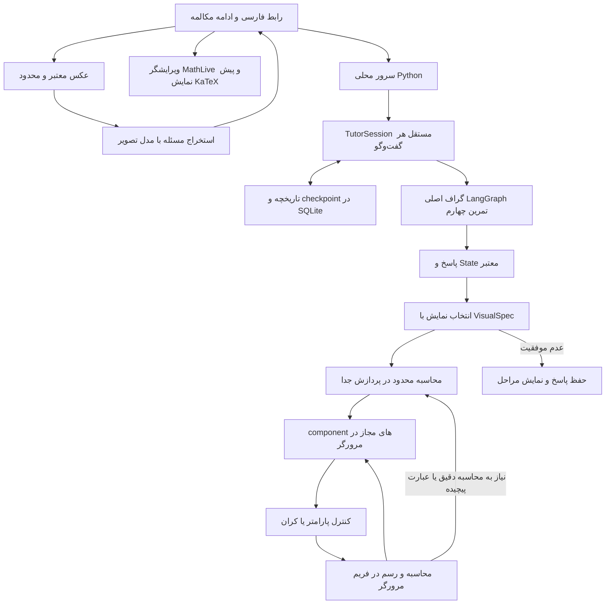

# معماری PROJECT_QWEN: GENERATIVE_MATH_UI

هستهٔ مدرس همان گراف تمرین چهارم است. لایهٔ نمایش پس از خروجی آن کار می‌کند و مسیر حل یا بازبینی هسته را جایگزین نمی‌کند.

## هسته و حافظه

۹ فایل هسته، شامل `agent.py`، provider، محاسبه‌گر و گراف، byte-identical با commit ثبت‌شده در [SOURCE.json](tutor_core/SOURCE.json) هستند. گراف شامل تحلیل، شفاف‌سازی، تعیین سطح، طرح درس، توضیح/حل، محاسبه، بازبینی، اصلاح و finalize است. سقف اصلاح پیش‌فرض یک بار است.

هر گفت‌وگو یک `TutorSession` و provider دارد. هر Session هم‌زمان فقط یک سؤال اجرا می‌کند؛ درخواست دوم هنگام busy رد می‌شود. کارها در pool محدود اجرا و با شناسهٔ تصادفی و Session مربوط polling می‌شوند. پروگرس نام مرحلهٔ جاری را نشان می‌دهد؛ State نهایی trace تکمیل‌شدهٔ هسته را دارد. پرسش ناقص در pending_request حفظ می‌شود. Session بعد از بازگشت گراف و بدون خطای اجرایی به‌روز می‌شود.

`history.py` نوبت موفق و checkpoint شامل history محدود، pending_request، previous_level، last_state، سطح و زبان را در یک تراکنش SQLite ذخیره می‌کند. Session هنگام ادامهٔ گفت‌وگو از checkpoint بازیابی می‌شود؛ فایل‌های تاریخچهٔ زنده و دمو جدا هستند. جلسهٔ idle از RAM خارج می‌شود ولی سابقه باقی می‌ماند. حذف در رابط تأیید دارد و حین اجرای پاسخ مجاز نیست. خروجی API checkpoint داخلی را افشا نمی‌کند.

`ui_provider.py` یک subclass از provider اصلی است؛ تنها در پرامپت توضیح/حل/اصلاح، LaTeX برای متن آموزشی درخواست می‌کند. قالب result و tool expression هسته تغییر نمی‌کند. ویرایشگر MathLive فرمول را در مکان نشانگر به سؤال درج می‌کند؛ `math-text.mjs` delimiterهای LaTeX و تعدادی فرمول ASCII قدیمی را جدا می‌کند. KaTeX با trust=false فرمول را render می‌کند و HTML کاربر/مدل فقط text node است. نمادهای ورودی متنوع‌اند؛ پشتیبانی از تمام دستورهای TeX یا حل تمام موضوعات ریاضی ادعا نمی‌شود.

`view-state.mjs` برای تغییر نمای گفتگو شمارهٔ نسخه می‌سازد؛ پاسخ دیررسِ بارگذاری قبلی پس از انتخاب جدید یا ساخت گفت‌وگوی تازه کنار گذاشته می‌شود. قبل از بارگذاری، `resetLab` کنترل‌ها، نمودار، فرمول‌ها، اندازه‌ها و tooltip را پاک و محاسبات بصری قبلی را با epoch بی‌اعتبار می‌کند. پس از بارگذاری، آخرین نوبت از VisualSpec و دادهٔ ذخیره‌شده به‌صورت clone فعال می‌شود. آزمایشگاهِ گفت‌وگوی تازه تا دریافت پاسخ خالی می‌ماند.

`stepHeading` عنوان مرحله را بدون شکستن LaTeX کوتاه می‌کند. selectorهای خلاصهٔ مراحل فقط فرزند مستقیم را هدف می‌گیرند؛ spanهای داخلی KaTeX کسر و توان را پنهان نمی‌کنند. wrapper فرمول inline با فضای عمودی و اسکرول افقی محلی، متن RTL و ریاضی LTR را داخل کادر نگه می‌دارد. `editor-config.mjs` نمادهای ۱۲ قالب و پنج چیدمان فارسی کیبورد را تعریف می‌کند؛ MathLive ورودی و KaTeX نماد دکمه‌ها را نمایش می‌دهد. نام قالب‌ها در tooltip و aria-label است. ارتفاع کیبوردِ داخل dialog با geometrychange و فضای لازم برای padding تنظیم می‌شود تا ردیف آخر هنگام تغییر تب بریده نشود.

`image_input.py` فقط base64 فایل واقعی PNG/JPEG/WebP را می‌پذیرد، حجم و ابعاد را محدود و فایل را decode/re-encode می‌کند. EXIF حذف، تصویر به حداکثر ۲۰۰۰ پیکسل و thumbnail به ۴۴۰ پیکسل محدود می‌شود. URL دلخواه ورودی پذیرفته نمی‌شود. `VisionReader` با مدل جداگانهٔ VISION_MODEL فقط صورت مسئله را استخراج می‌کند؛ پاسخ محدود و schema آن بررسی می‌شود. متن در composer قابل ویرایش است و پس از ارسال به همان TutorSession می‌رود. حداکثر دو خواندن عکس هم‌زمان و ۲۴ پیش‌نمایش موقت یک‌ساعته در RAM مجازند. تصویر اصلی ذخیره نمی‌شود؛ فقط thumbnail در نتیجهٔ نوبت ذخیره می‌شود.

## قرارداد Generative UI

`VisualSpec` با Pydantic اعتبارسنجی می‌شود: kind از شش نوع مجاز، عنوان و توضیح محدود، عبارت، بازه، نقطهٔ تماس یا کران‌ها، حداکثر چهار پارامتر و فرمول‌های LaTeX. پارامترها فقط `a,b,c,y,z,t,n` هستند و متغیر افقی `x` است. انواع: `steps,function,tangent,integral,geometry,matrix`.

مدل در فراخوانی `design_visual` و با زمینهٔ پاسخ پذیرفته‌شده نمایش را انتخاب می‌کند. برای مسئلهٔ صریح مشتق/انتگرال، درخواست ابزار گراف مبنای عبارت و کران‌های اولیه است؛ نمایش مدل نمی‌تواند مسئلهٔ اصلی را عوض کند. مثال مفهومی باید به‌عنوان مثال معرفی شود. اگر قرارداد مدل نامعتبر باشد، fallback از عملیات شناخته‌شدهٔ هسته استفاده می‌کند یا به مراحل برمی‌گردد. `visual_source` مسیر model/fallback/none را ثبت می‌کند.

این روش، Generative UI بر اساس schema و componentهای از پیش تعریف‌شده است. مدل بین این componentها و داده/کنترل‌های آن‌ها انتخاب می‌کند؛ کد UI دلخواه اجرا نمی‌شود.

## محاسبهٔ نمایش

parser محدود هسته دوباره استفاده می‌شود. نام پارامترهای UI به‌طور هم‌زمان به نمادهای مجاز parser نگاشت می‌شود؛ خود فایل‌ها و جدول نمادهای هسته تغییر نمی‌کنند. مقدار پارامترها جایگذاری و منحنی در ۳۰۱ نقطه محاسبه می‌شود. مشتق و انتگرال با SymPy هستند. پارامتر/کران نامعتبر، مقادیر نامتناهی و عبور بازهٔ انتگرال از قطب شناخته‌شده رد می‌شوند. منحنی در قطب‌های چندجمله‌ای شناخته‌شده قطع می‌شود.

محاسبهٔ اولیهٔ نمایش و fallback در subprocess با UTF-8 و سقف هفت ثانیه است. تغییر اسلایدر برای تابع‌ها، مماس و هندسهٔ پشتیبانی‌شده در `fast-math.mjs` محاسبه می‌شود. این فایل یک parser محدود عملیات مجاز دارد؛ `eval` یا `Function` استفاده نمی‌کند. طول، تعداد توکن/نود، عمق، توان و نام‌ها محدودند. مشتق با انتشار مقدار و مشتق از درخت عبارت و قوانین مشتق‌گیری محاسبه می‌شود. پادمشتق چندجمله‌ای از ضرایب آن به دست می‌آید. انتگرال‌های دیگر با Simpson و برچسب تقریب عددی فوراً نمایش داده و پس از توقف حرکت، نتیجهٔ محاسبه‌گر سرور جایگزین می‌شود.

رویدادهای input با `requestAnimationFrame` ادغام می‌شوند؛ آخرین پارامتر همان فریم رسم می‌شود و حرکت سریع اسلایدر صف درخواست سرور ایجاد نمی‌کند. برای fallback درخواست‌ها debounce/serialize و پاسخ‌های قدیمی با epoch رد می‌شوند. نشانگر کوچک محاسبهٔ پس‌زمینه، نمودار را نمی‌پوشاند. گراف آموزشی، history و جواب قبلی با کاوش بصری تغییر نمی‌کنند.

## API محلی

| مسیر | کار |
|---|---|
| `GET /api/health` | وضعیت تنظیمات و نام مدل، بدون کلید |
| `POST /api/sessions` | ایجاد گفت‌وگوی مستقل |
| `POST /api/messages` | اجرای نوبت از همان Agent |
| `GET /api/jobs/:id?session_id=...` | پیشرفت یا نتیجهٔ همان گفت‌وگو |
| `POST /api/visual` | محاسبهٔ نمایش و پارامترهای اعتبارسنجی‌شده |
| `GET /api/history` | فهرست تاریخچه، مرتب بر اساس آخرین پاسخ |
| `GET /api/conversations/:id` | نوبت‌های قبلی برای باز کردن گفت‌وگو |
| `POST /api/conversations/rename` | تغییر عنوان |
| `POST /api/conversations/delete` | حذف سابقه پس از تأیید رابط |
| `POST /api/images` | اعتبارسنجی عکس و استخراج مسئله |
| `POST /api/reset` | آزاد کردن Session از RAM؛ سابقه روی دیسک می‌ماند |

static فقط از پوشهٔ `static` سرو می‌شود و فایل‌های `.env` یا Python در دسترس مرورگر نیستند. Host/Origin محدود به loopback همان پورت‌اند. متن کاربر و مدل با DOM text node ساخته می‌شود؛ KaTeX با `trust:false` و محدودیت expansion اجرا می‌شود. کلید در server-side settings می‌ماند. این کنترل‌ها برای ابزار محلی‌اند؛ استقرار عمومی به سرور تولیدی، احراز هویت و سیاست نگهداری داده نیاز دارد.

## نگاشت به معیارهای تمرین

| بخش | شاهد |
|---|---|
| UX/UI — ۵۰ | فارسی RTL، فرمول LTR، تاریخچهٔ پایدار، ویرایشگر فرمول، ورودی عکس، مکالمه، سطح، پروگرس، مراحل بازشونده، طراحی دسکتاپ/موبایل |
| Generative UI — ۵۰ | انتخاب VisualSpec توسط مدل، نمودار/مماس/انتگرال/هندسه/ماتریس/مراحل و کنترل محلی |
| توضیح ساده — ۵۰ | همان assess_level، plan_lesson، توضیح/حل و بازبینی ایجنت قبلی، مثال و پرسش یادگیری |

این جدول پوشش نیازمندی‌ها را نشان می‌دهد؛ امتیاز نهایی به ارزیابی مدرس بستگی دارد.
