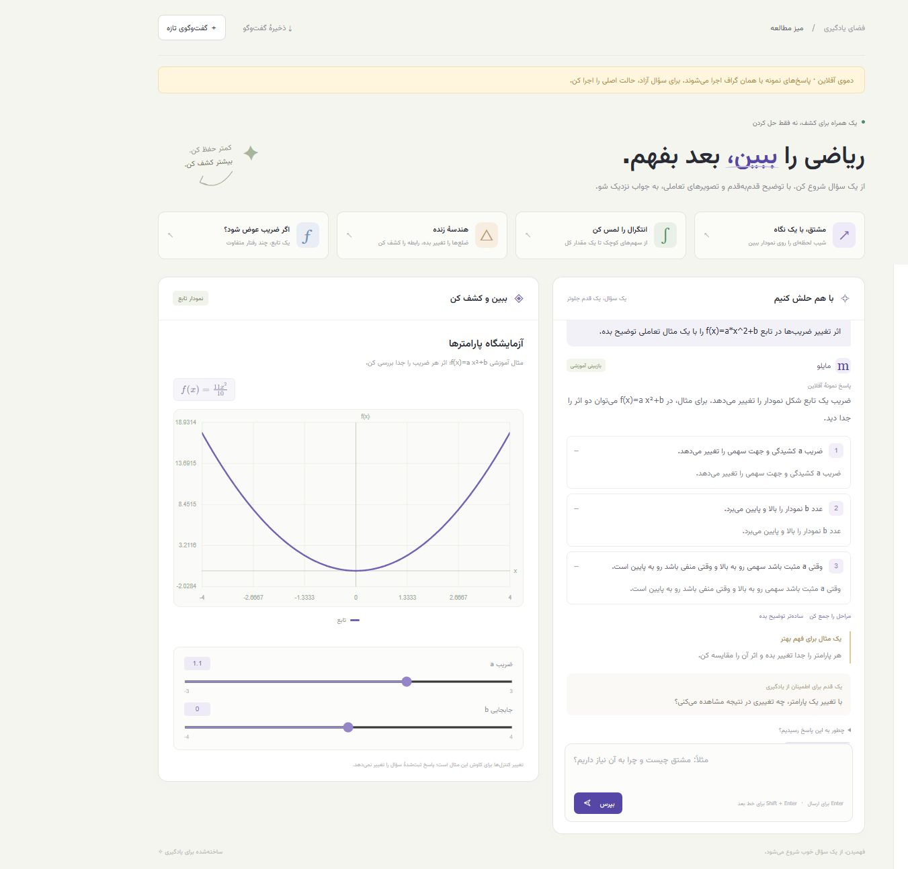

# تمرین پنجم — Generative Math UI

مدرس ریاضی مایلو با رابط فارسی و نمایش‌های تعاملی متناسب با سؤال. پاسخ از **همان گراف LangGraph تمرین چهارم** می‌آید؛ لایهٔ Generative UI نمایش مناسب را به آن اضافه می‌کند.



تصویر از حالت نمونهٔ آفلاینِ مشخص‌شده در رابط است؛ اجرای اصلی به مدل واقعی متصل می‌شود.

## اجرای ساده روی سیستم محسن

در ترمینال VS Code:

```powershell
cd "D:\StarCoach\01-Agentic AI Bootcamp\01-HW\05\GENERATIVE_MATH_UI"
.\.venv\Scripts\python.exe app.py
```

**بدون آرگومان** اجرا می‌شود و مرورگر را روی `http://127.0.0.1:8505` باز می‌کند. محیط و `.env` محلی آماده‌اند. برای توقف، در ترمینال `Ctrl+C` بزن. فایل `.env` در Git منتشر نمی‌شود.

## نصب از ریپوی گیت‌هاب

Python 3.10 یا جدیدتر لازم است؛ محیط بررسی این نسخه Windows و Python 3.14 است.

```powershell
git clone https://github.com/mohsenalipour/starcoach-hw05-generative-math-ui.git
cd starcoach-hw05-generative-math-ui
.\setup.ps1
notepad .env
.\.venv\Scripts\python.exe app.py
```

در `.env` کلید، مدل و آدرس سرویس سازگار با OpenAI را تنظیم کن. نمونه برای AvalAI و `gpt-4.1-mini` است؛ Metis نیز مانند پروژهٔ قبلی پشتیبانی می‌شود. کلید فقط در سرور Python می‌ماند و به مرورگر ارسال نمی‌شود. تنظیماتِ موجود جایگزین نمی‌شوند. متغیرهای محیطی موجود بر `.env` اولویت دارند. پس از تغییر تنظیمات، برنامه را دوباره اجرا کن.

اگر PowerShell اجرای اسکریپت نصب را محدود کرد، نصب دستی:

```powershell
python -m venv .venv
.\.venv\Scripts\python.exe -m pip install -r requirements.txt
Copy-Item .env.example .env
notepad .env
.\.venv\Scripts\python.exe app.py
```

در Linux/macOS از `python3 -m venv .venv`، `.venv/bin/python -m pip install -r requirements.txt` و `.venv/bin/python app.py` استفاده کن. فایل `.env.example` را یک بار به `.env` کپی کن.

فایل‌های فونت، KaTeX و رابط داخل ریپو هستند؛ برای اجرا **Node، npm، build و CDN لازم نیست**. اینترنت و اعتبار API فقط برای پاسخ مدل لازم‌اند. هنگام اشغال بودن پورت، `app.py --port 8506` قابل استفاده است.

## چه چیزی نمایش داده می‌شود؟

| ماهیت سؤال | نمایش |
|---|---|
| تابع یک‌متغیره با ضرایب | نمودار و اسلایدرهای پارامتر |
| مشتق | نمودار تابع، خط مماس و تغییر نقطهٔ تماس |
| انتگرال | ناحیهٔ علامت‌دار، کنترل دو کران و محاسبهٔ مقدار انتگرال |
| مثلث قائم‌الزاویه یا دایره | شکل و کنترل طول‌ها/شعاع، اندازه‌های محاسبه‌شده |
| ماتریس عددی کوچک | ماتریس خوانا و دترمینان |
| سایر موضوعات | مراحل توضیح و فرمول‌های آموزشی |

سؤال‌های پیشنهادی متن سؤال را آماده می‌کنند؛ برای ارسال، «بپرس» یا Enter را بزن. ادامهٔ مکالمه، تعیین سطح، زبان، باز کردن مراحل، مشاهدهٔ مسیر پاسخ، انتخاب نمایش پاسخ‌های قبلی و ذخیرهٔ گفت‌وگو در JSON در دسترس‌اند. در موبایل، سطح و زبان از دکمهٔ «تنظیمات» قابل تغییرند.

**تغییر اسلایدر، کاوش بصری را تغییر می‌دهد؛ پاسخ ثبت‌شدهٔ سؤال را بازنویسی نمی‌کند.** برای حل مسئله با عددهای جدید، سؤال تازه بپرس. تابع‌ها، مماس و هندسهٔ پشتیبانی‌شده در همان فریم مرورگر محاسبه و رسم می‌شوند؛ برای هر حرکت اسلایدر درخواست سرور یا مدل لازم نیست. انتگرال چندجمله‌ای با پادمشتق محلی محاسبه می‌شود؛ برای سایر انتگرال‌های قابل محاسبه، تقریب عددی فوری با برچسب روشن و سپس نتیجهٔ سرور نمایش داده می‌شود. عبارت‌های پیچیده‌تر از مسیر محدود قبلی استفاده می‌کنند. نمونهٔ نمودار اولیه با برچسب «پیش‌نمایش آموزشی» نمایش داده می‌شود و پاسخ به سؤال کاربر محسوب نمی‌شود.

فرمول‌های دارای delimiter استاندارد LaTeX با KaTeX نمایش داده می‌شوند؛ نمودارها SVG هستند. متن نامعتبر به متن خوانا برمی‌گردد. سمت فرمول‌ها چپ‌به‌راست و متن فارسی راست‌به‌چپ است.

## اتصال به تمرین چهارم

فایل‌های داخل `tutor_core` از [ریپوی تمرین چهارم](https://github.com/mohsenalipour/starcoach-hw04-math-tutor) بدون تغییر کپی شده‌اند. [SOURCE.json](tutor_core/SOURCE.json) commit منبع و SHA-256 هر فایل را ثبت می‌کند. ده نود، مسیرهای شرطی، بازبینی، اصلاح محدود و حافظهٔ `TutorSession` حفظ شده‌اند.

`core_bridge.py` هسته را وارد می‌کند؛ `app.py` یک Session برای هر گفت‌وگو می‌سازد و `session.send` را اجرا می‌کند. پس از پاسخ، `visuals.py` از مدل یک **VisualSpec اعتبارسنجی‌شده** می‌گیرد. مرورگر فقط componentهای مجاز را با آن می‌سازد. مدل HTML یا JavaScript اجرایی تولید نمی‌کند. اگر طراحی نمایش یا محاسبهٔ آن شکست بخورد، پاسخ آموزشی سالم حفظ و نمایش مراحل استفاده می‌شود.

معنای بررسی پاسخ از هستهٔ قبلی حفظ شده است: `symbolically_checked` تطبیق نتیجه با ابزار، `reviewed_with_tool` بازبینی با محاسبه ولی بدون تطبیق قطعی، و `model_reviewed` بازبینی مدل است. رنگ یا نمودار به‌تنهایی تأیید صحت همهٔ توضیح‌ها نیست.

## دمو بدون API

```powershell
.\.venv\Scripts\python.exe app.py --demo
```

در این حالت، پاسخ‌های آموزشی نمونه از provider محلی می‌آیند و **همان گراف واقعی** اجرا می‌شود. حالت آفلاین با بنر و برچسب پاسخ مشخص است؛ مدل زنده نیست و سؤال آزاد را پشتیبانی نمی‌کند. چهار کارت پیشنهادی، دایره، مثال ماتریس و شفاف‌سازی معادله برای این حالت آماده‌اند. اجرای عادی بدون `--demo` به مدل واقعی وصل می‌شود.

## تست و ارائه

```powershell
.\.venv\Scripts\python.exe -X utf8 -m unittest discover -s tests -v
```

[DEMO.md](DEMO.md) ترتیب ارائه، [ARCHITECTURE.md](ARCHITECTURE.md) جریان داده و [TESTING.md](TESTING.md) شواهد بررسی را توضیح می‌دهند. تست‌های خودکار از provider کنترل‌شده/محلی استفاده می‌کنند؛ اجرای مدل زنده جدا بررسی شده است. GitHub Actions برای اجرا لازم نیست.

تست محاسبهٔ سریع مرورگر برای توسعه، با Node موجود روی سیستم: `node --test tests/fast-math.test.mjs`. Node برای اجرای برنامه لازم نیست.

## محدودهٔ نسخه

این برنامه یک ابزار محلی است و فقط روی loopback گوش می‌دهد؛ سرور stdlib برای استقرار عمومی تولیدی در نظر گرفته نشده است. حافظهٔ گفت‌وگو در RAM و محدود به ۱۲ پیام است؛ با توقف سرور از بین می‌رود. خروجی JSON snapshot است و بازیابی خودکار جلسه ندارد.

نمایش‌ها شامل تابع یک‌متغیره و تا چهار پارامتر، مشتق/انتگرال در بازهٔ محدود، مثلث قائم‌الزاویه/دایره و ماتریس عددی حداکثر ۴×۴ هستند. نمودار سطح سه‌بعدی و شکل هندسی دلخواه پیاده‌سازی نشده‌اند؛ سؤال‌های دیگر همچنان توضیح و مراحل دارند. نمودار در ۳۰۱ نقطه نمونه‌برداری می‌شود؛ محاسبه محدودیت زمان و پیچیدگی دارد. ناسازگاری بازه یا شکست محاسبه به‌صورت پیام نمایش داده می‌شود.

KaTeX با مجوز MIT و Vazirmatn با مجوز OFL استفاده شده‌اند؛ مجوزها در `static/vendor` هستند. منبع رسمی: [KaTeX](https://katex.org/docs/autorender.html)، [Python HTTP server](https://docs.python.org/3/library/http.server.html).

برای بازسازی دارایی‌های مرورگر هنگام توسعه: `npm ci --ignore-scripts` سپس `npm run vendor`. نسخه‌ها در `package-lock.json` ثبت شده‌اند.
